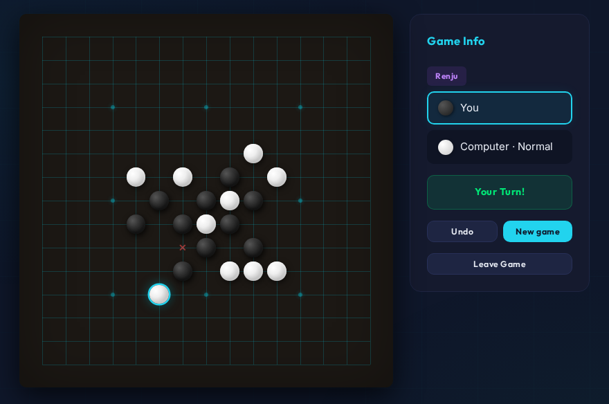
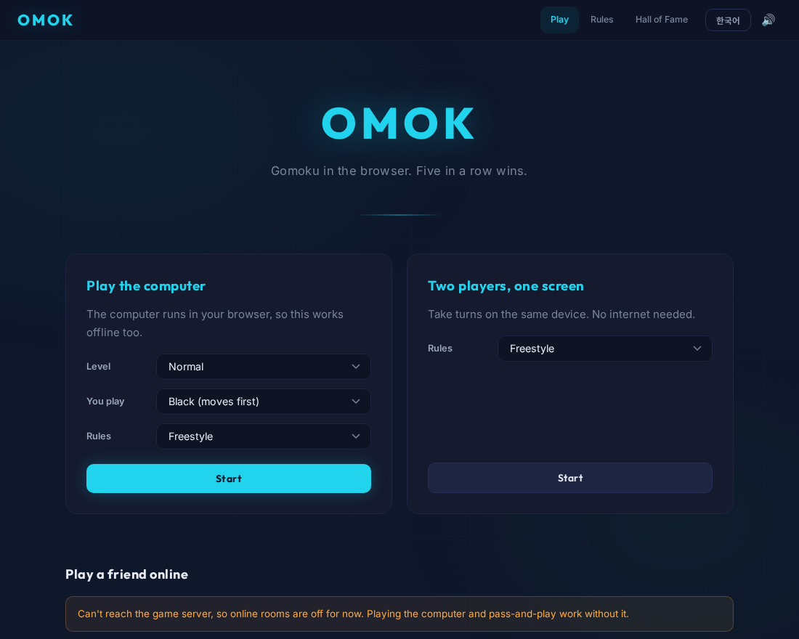
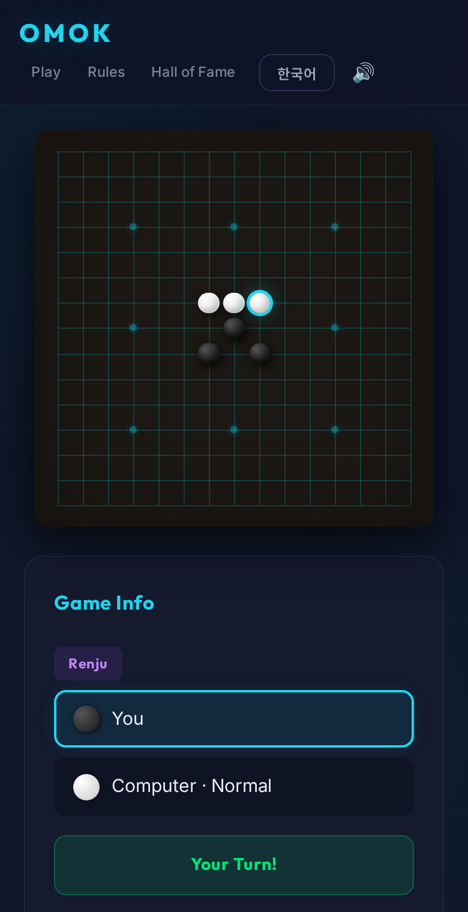

# Omok

Gomoku (오목) in the browser. Play the computer, pass the device back and forth, or invite a friend to an online room. Plain HTML, CSS and JavaScript with no build step.



## What it does

- **Computer opponent** with three levels. It runs in the browser, so it works offline, and it thinks in a Web Worker so the page stays responsive (on `file://`, where workers are blocked, it falls back to the main thread).
- **Freestyle and Renju rules.** Under Renju, Black's forbidden points (double three, double four, overline) are marked on the board and can't be played. The check follows the RIF definitions, including split shapes like `●·●●` and threes that only look open.
- **Two players on one device**, with undo.
- **Online rooms** on Supabase: room codes and invite links, an optional bet, taunts the winner can send after the game, rematches with colors swapped, and a Hall of Fame with move-by-move replays.
- English and Korean UI, keyboard play (arrow keys and Enter), sound effects synthesized with the Web Audio API.

<p>
  
  
</p>

## Status

This is a side project. The Supabase project behind online play is currently paused, so the lobby says online rooms are unavailable. Playing the computer and pass-and-play don't need a server and work fully.

## Running it

Serve the folder with any static file server:

```sh
python3 -m http.server 8000
# then open http://localhost:8000
```

Opening `index.html` straight from disk also works, but browsers don't allow Web Workers on `file://`, so the computer then thinks on the main thread.

Tests cover the rules and the computer player and need Node 18 or newer, nothing else:

```sh
node --test
```

## Online play

1. Create a Supabase project and run [`setup.sql`](setup.sql) in its SQL editor. It is safe to run again, but it is written for a new project: tables left over from earlier versions of this repo have a different shape and should be dropped first.
2. Put the project URL and its publishable (anon) key in [`js/config.js`](js/config.js).

The publishable key is meant to be public. There are no accounts, so what it can do is limited by the database instead: room codes and names have a fixed format, moves must alternate colors in order with one stone per point, a trigger only allows rooms to go waiting → playing → finished, and a Hall of Fame entry can only be deleted with the token its winner received. That keeps the data consistent, but a modified client could still play for the other side or ignore Renju rules, since wins and forbidden moves are checked in the browser. It's fine for playing with friends, not for anything with stakes.

## How the computer plays

Every candidate point near the stones gets a score from the shapes it makes along its four lines, for both sides (a five, an open four, a four, an open three and so on, classified from an 11-cell window and cached). Before falling back to that score, the engine:

1. takes a five, or blocks the opponent's five;
2. looks for a forced win made only of fours (VCF);
3. on Hard, also looks for forced wins that use threes (VCT);
4. if the opponent threatens an open four or another double threat, only considers moves that stop it.

Hard also skips moves that leave the opponent a VCF and looks one reply ahead. Easy skips the searches, sometimes ignores open threes and picks among its top few moves. In 120 self-play games against Normal (both colors, both rule sets), Hard won 73, lost 14 and drew 33. Normal won 39 of 40 games against Easy, with one draw. Under Renju the engine never plays a forbidden point as Black, and as White it doesn't waste moves blocking points Black isn't allowed to use.

## Layout

| Path | |
| --- | --- |
| `js/rules.js` | Win check and Renju forbidden moves. No DOM, shared by the page, the worker and the tests |
| `js/ai.js`, `js/ai-worker.js` | Computer player |
| `js/local-game.js` | Games against the computer and on one device |
| `js/game.js` | Online rooms |
| `js/lobby.js`, `js/hall.js` | Lobby and Hall of Fame |
| `setup.sql` | Database tables, constraints and row level security |
| `tests/` | `node --test` suites |

## Limitations

- Renju is played with a free opening. Tournament opening rules (Soosõrv-8, Taraguchi and others) aren't implemented, and a forbidden point is simply not playable instead of losing the game.
- The computer only searches forced sequences of fours and threes, plus one reply ahead. It has no deeper game-tree search, so an experienced player will find its weak spots.
- Online rooms have no accounts, see above.

## 한국어

브라우저에서 두는 오목입니다. 컴퓨터와 두거나, 한 기기에서 둘이 번갈아 두거나, 방 코드로 친구를 불러 온라인으로 둘 수 있습니다. 빌드 과정 없이 HTML, CSS, JavaScript로만 만들었습니다.

- 컴퓨터 상대는 쉬움, 보통, 어려움 세 단계이고 Web Worker에서 돌아가서 인터넷 없이도 됩니다.
- 자유룰과 렌주룰을 지원합니다. 렌주룰에서는 흑의 금수(삼삼, 사사, 장목)를 국제렌주연맹(RIF) 정의대로 판정하고 판 위에 ✕로 표시합니다.
- 온라인 대국은 Supabase를 씁니다. 지금은 Supabase 프로젝트가 일시 중지되어 있어 온라인 방은 쓸 수 없다고 안내되고, 컴퓨터 대국과 한 화면 2인 대국은 그대로 됩니다.
- 실행은 `python3 -m http.server 8000` 같은 정적 서버로 폴더를 열면 되고, 테스트는 `node --test`입니다.
